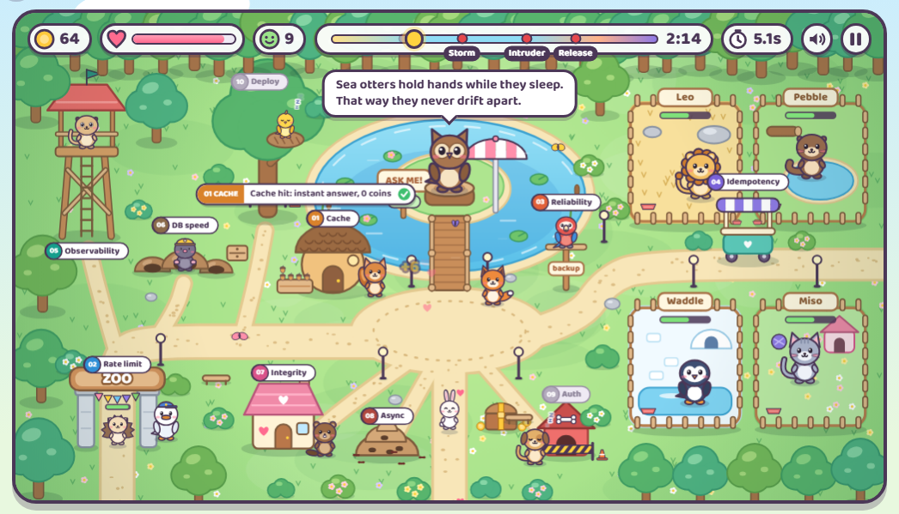
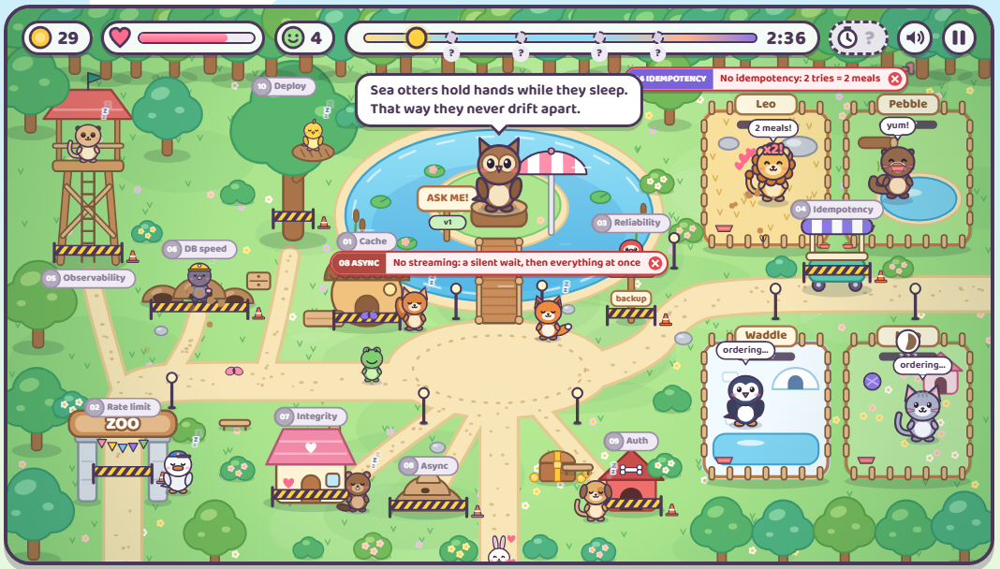
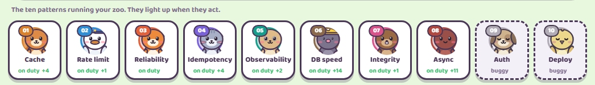

<div align="center">

# Zoo Ops

**Learn 10 backend system design patterns by keeping a cute zoo alive.**

You write the missing backend code. The animals show you, live, what your code changes.

[](https://github.com/aliamrrr/zoo-ops/actions/workflows/ci.yml)




</div>

## Play in one minute

You need [git](https://git-scm.com/downloads) and either **Python 3.11+** or **Docker**.
No Redis, no Postgres, no API key: everything the zoo needs is simulated.

```bash
git clone https://github.com/aliamrrr/zoo-ops.git
cd zoo-ops
```

| Your machine | Run | |
| --- | --- | --- |
| **Windows** | `.\zoo.cmd` | or double-click `zoo.cmd` in the folder |
| **macOS, Linux, WSL** | `./zoo.sh` | |
| **Docker** (any OS) | `docker compose up` | then open http://localhost:8000 |

The first run sets everything up (about a minute), then asks which mode to play and opens
the game in your browser. Play one shift first, see everything go wrong, then start building.

To skip the question, name the mode: `.\zoo.cmd play hard`, `./zoo.sh play hardpp`.
In the game, the title screen also switches between the three modes.

## Three ways to play

| Mode | Command | What you get |
| --- | --- | --- |
| **Zoo Ops** (Classic) | `play classic` | Ten guided levels in [`levels/`](levels). Each pattern is one file with TODOs and a docstring spec. |
| **Zoo Ops [Hard]** | `play hard` | A real FastAPI service in [`hard/`](hard), with layers, migrations, Redis, jobs and auth. Ten tickets, no TODOs: you find where the code goes. |
| **Zoo Ops [Hard++]** | `play hardpp` | A distributed zoo in [`hardpp/`](hardpp), simulated deterministically. Ten interview-grade problems: stampedes, GCRA, hedged requests, outbox, tail sampling, resharding, sagas, partitioned logs, geo search, fencing tokens. |

Each mode keeps its own progress and its own day counter.

### Architecture first: the Blueprint

In the two hard modes, the game has a **Blueprint** tab: the architecture of the project,
drawn as boxes and arrows, with empty places. Before writing code for a ticket, you drag its
block (the cache, the limiter, the outbox relay...) to where it belongs and link it to the
components it talks to. The game checks the design and answers with hints, never with the
solution. A ticket ships, and its keeper wakes up, only when **its acceptance tests pass and
its block sits in the right place**.

## How you play

You are **Bao, the panda keeper**. Click a target and Bao walks there to do the job, so the
order you click in is your route:

- **Click a visitor** in the line to send their question across the bridge to the Owl. Serve several in a row to build a **combo**. Golden **VIPs** pay triple but hate waiting.
- **Click an animal** to feed it. Once is enough: overfed animals get sick.
- **Click dirt** to clean a pen, and **the pink cottage** when families wait to adopt.
- **A keeper is asleep?** Do its job by hand: click the pigeons to shoo them, click the raccoon to scare it off, run to the kiosk to roll back a bad release. Building the pattern is what stops you running.
- Each shift you survive unlocks the **next day**, with more visitors. Coins, reputation and visitors served make your score, from zero to three stars.

Three things always tell you which pattern is at work:

1. **In the world**: a labelled callout pops where it happens, like `04 IDEMPOTENCY  3 tries, still 1 meal`.
2. **The dock** beside the zoo: the badge of that pattern flashes and counts how often it helped or hurt.
3. **The shift journal**: the story of the shift, each line tagged with its pattern.

| Nothing built yet | The dock: one badge per pattern |
| --- | --- |
|  |  |

## The ten patterns

| # | Pattern | Keeper | Not built | Built |
| --- | --- | --- | --- | --- |
| 01 | **Cache** (Redis cache-aside, TTL, LLM and embedding caches) | Hazel the squirrel | Every question is paid again and visitors wait | Repeated questions come from the nut store, instant and free |
| 02 | **Rate limiting + API gateway** (token buckets per key) | Gus the goose | The pigeon swarm jams the kiosk | Gus throttles the pigeons at the gate |
| 03 | **Reliability** (timeouts, retries with jitter, circuit breaker, fallback) | Rusty the fox | In the storm, questions sink and visitors leave | Rusty retries, opens the breaker, the Parrot answers |
| 04 | **Idempotency** (Idempotency-Key, UNIQUE, upserts) | Miso the cat | Network retries feed an animal 2 or 3 times, it gets sick | Each order is served once, retries are ignored |
| 05 | **Observability** (JSON logs, p95, SLO burn-rate alerts) | Mika the meerkat | You fly blind: no bars, no forecast, no pager | Hunger and patience bars, wait p95, incident forecast, pager |
| 06 | **Database performance** (indexes, N+1, cursor pagination, pooling) | Digby the mole | Every action lags by a second | Actions are instant |
| 07 | **Data integrity** (transactions, locks, optimistic locking) | Bea the beaver | Two families leave with the same kitten | One kitten, one family |
| 08 | **Async processing** (queues, workers, DLQ, SSE streaming) | The ant colony | Silent waits, and you clean every pen by hand | The Owl streams word by word, the ants clean in the background |
| 09 | **Auth + security** (JWT, API keys, tenants, secrets) | Rex the dog | The raccoon walks in and steals coins | Rex refuses the forged badge |
| 10 | **Deployment + scaling** (canary, rollback, health checks, graceful shutdown) | Pip the canary | A bad release breaks the kiosk for everyone | The canary catches it and rolls back |

In Hard++ the same ten keepers guard ten harder problems:

| # | Ticket | Pattern |
| --- | --- | --- |
| 01 | The viral question | Singleflight, stale-while-revalidate, consistent hashing with virtual nodes |
| 02 | One limit for the whole planet | Distributed GCRA over compare-and-set, immune to clock skew |
| 03 | The long tail | Hedged requests, per-replica concurrency limits, priority load shedding |
| 04 | Billed twice, or never | Transactional outbox, relay, idempotent consumer |
| 05 | The trace that stops at the queue | W3C trace context across a queue, tail-based sampling |
| 06 | The registry outgrew its shards | Consistent-hash sharding, online rebalancing, k-way merge pagination |
| 07 | The half-finished adoption | Orchestrated saga with compensations and crash recovery |
| 08 | Events out of order | Keyed partitions, consumer group rebalancing, commit after processing, fencing |
| 09 | Dispatching keepers across the city | Geospatial grid index, exact k-nearest neighbours |
| 10 | Two night watchmen | Leases and fencing tokens |

## The learning loop

Each Classic level lives in its own folder:

```
levels/l04_idempotency/
  README.md             the pattern in a few lines, its bugs and symptoms, hints
  idempotency.py        the file you edit: every TODO raises NotImplementedError
  test_idempotency.py   the contract your code must meet
  scene.py              a small story that runs your code and checks the zoo
```

1. Pick a level and read its `README.md`.
2. Replace each `raise NotImplementedError(...)` with your code. The docstring is the spec.
3. Run the bench until it is green: `.\zoo.cmd test 4` or `./zoo.sh test 4`.
4. Save, and look at the game: the keeper is awake, and that part of the shift now works.

Work on your own branch, so you can pull new levels without conflicts:

```bash
git switch -c my-solutions
```

## Commands

Every command works the same way through `.\zoo.cmd` (Windows), `./zoo.sh` (macOS, Linux, WSL)
or `docker compose run --rm zoo` (Docker).

| Command | What it does |
| --- | --- |
| `play [classic\|hard\|hardpp]` | Opens the game. Without a mode it asks. It reloads when you save a level |
| `test` | Runs every level's tests with a colored scoreboard |
| `test 3 7` | Only levels 3 and 7, listing every test |
| `test --mode hard 4 -v` | The acceptance tests of a Hard ticket |
| `scene 4` | Plays the story of level 04 in the terminal |
| `reset 4` | Restores level 04 to the version you started from |
| `reset --mode hard --project` | Restores the whole Hard project |
| `modes` | Lists the three modes |

With Docker, `docker compose run --rm --service-ports zoo play hard` starts in Hard mode.
Plain `pytest` works too, for your IDE or debugger.

## How it works

- **No infrastructure needed.** Redis is emulated by `fakeredis`, SQLite stands in for Postgres, the LLMs (the Owl and the Parrot) are fakes with realistic latency and failures, and incidents run on simulated time.
- **Your code is never mocked.** Tests, scenes and the live game all call the same functions you write.
- **A broken level never breaks the game.** A TODO falls back to the naive behavior the pattern exists to prevent, and even a syntax error only takes down its own part of the zoo.
- **The hard modes are checked by their acceptance tests**, run in the background whenever a file of the project changes.

The architecture of the game itself is in [docs/ARCHITECTURE.md](docs/ARCHITECTURE.md), and
the decisions behind it in [docs/adr](docs/adr).

## Contributing

Ideas, bug reports and pull requests are welcome: a new incident, a new animal, a clearer
hint, a translation. See [CONTRIBUTING.md](CONTRIBUTING.md) and
[docs/authoring-levels.md](docs/authoring-levels.md). Please never commit level or ticket
solutions to `main`: the fun is in writing them, and CI refuses them.

## Author

Made by **Ali Anass Amradouch**.

- LinkedIn: https://www.linkedin.com/in/ali-anass-amradouch-321567255/
- Portfolio: https://aliamrrr.github.io/alianassamr.github.io/

If Zoo Ops helped you, a star on the repo helps other people find it.

## License

[MIT](LICENSE). The animals and the zoo are original artwork drawn in code.
