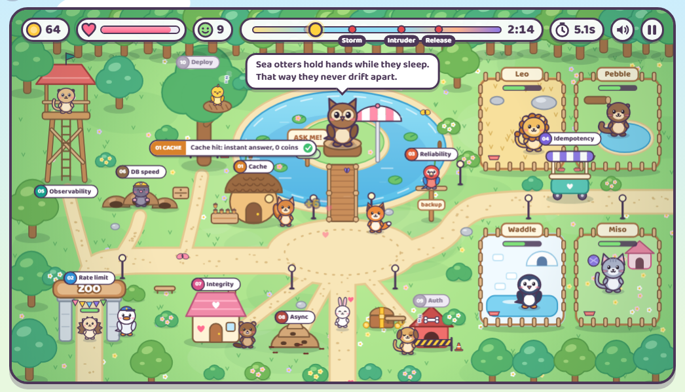
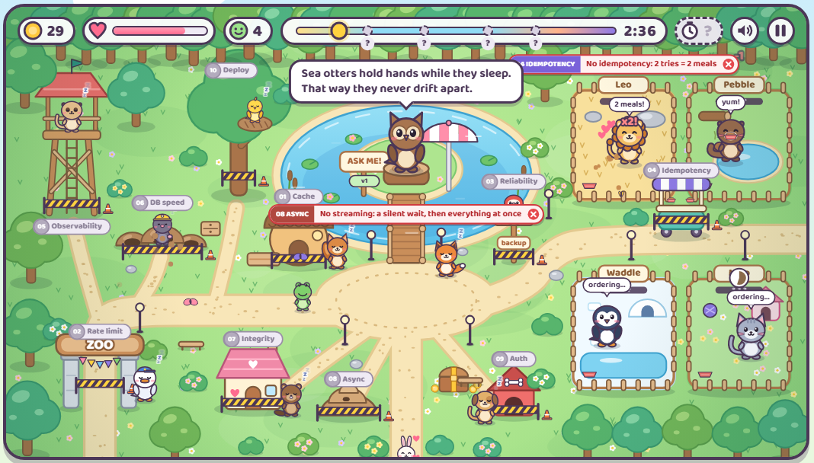
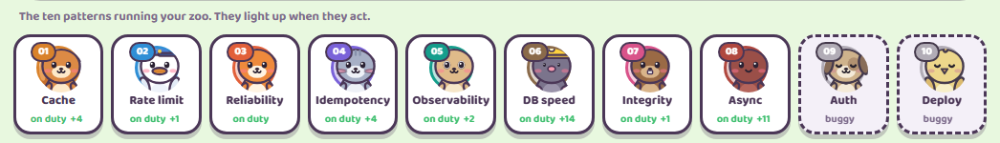

<div align="center">

# Zoo Ops

**Learn 10 backend system design patterns by keeping a cute zoo alive.**

You write the missing backend code. The animals show you, live, what your code changes.

[](https://github.com/aliamrrr/zoo-ops/actions/workflows/ci.yml)




</div>

## What is this?

Zoo Ops is a small browser game with a real Python backend. You run a zoo for a three-minute shift: visitors line up to ask the Owl questions, animals get hungry, pens get dirty, families adopt kittens, and incidents hit (a pigeon swarm, a storm, a raccoon, a bad release).

The zoo runs on **ten backend systems, one per system design pattern**, and each one has a piece of code missing: 20 to 40 lines that you write.

- A pattern you have not built yet has its keeper **asleep** behind caution tape, and the game shows you what that costs.
- A pattern you built **wakes its keeper up**, and you see it act in the world, with a label saying exactly what it just did.

It is made for people preparing system design interviews, juniors who want to feel why these patterns exist, and anyone who learns better by breaking things.

| Nothing built yet | The dock: one badge per pattern |
| --- | --- |
|  |  |

## Quick start

You need Python 3.11 or newer. Nothing else: no Redis, no Postgres, no Docker, no API key.

**Windows (PowerShell)**

```powershell
git clone https://github.com/aliamrrr/zoo-ops.git
cd zoo-ops
powershell -ExecutionPolicy Bypass -File install.ps1
.\.venv\Scripts\Activate.ps1
python -m zoo play
```

**macOS or Linux**

```bash
git clone https://github.com/aliamrrr/zoo-ops.git
cd zoo-ops
sh install.sh
source .venv/bin/activate
python -m zoo play
```

The game opens on http://127.0.0.1:8000. Play one shift first, see everything go wrong, then start building.

## How you play

Everything happens in the zoo, with the mouse:

- **Click a visitor** in the line to send their question across the bridge to the Owl.
- **Click an animal** to feed it. Once is enough: overfed animals get sick.
- **Click dirt** to clean a pen, and **the pink cottage** when families wait to adopt.
- Survive the incidents. Coins, reputation and visitors served make your score, from zero to three stars.

Three things always tell you which pattern is at work:

1. **In the world**: a labelled callout pops where it happens, like `04 IDEMPOTENCY  3 tries, still 1 meal`.
2. **The dock** under the zoo: the badge of that pattern flashes and counts how often it helped or hurt.
3. **The shift journal**: the story of the shift, each line tagged with its pattern. Click a tag to open its station.

## The ten patterns

| # | Pattern | Keeper | Not built, in the game | Built, in the game |
| --- | --- | --- | --- | --- |
| 01 | **Cache** (Redis cache-aside, TTL, LLM and embedding caches) | Hazel the squirrel | Every question is paid again and visitors wait | Repeated questions come from the nut store, instant and free |
| 02 | **Rate limiting + API gateway** (token buckets per key) | Gus the goose | The pigeon swarm jams the kiosk | Gus throttles the pigeons at the gate |
| 03 | **Reliability** (timeouts, retries with jitter, circuit breaker, fallback) | Rusty the fox | In the storm, questions sink and visitors leave | Rusty retries, opens the breaker, the Parrot answers |
| 04 | **Idempotency** (Idempotency-Key, UNIQUE, upserts) | Miso the cat | Network retries feed an animal 2 or 3 times, it gets sick | Each order is served once, retries are ignored |
| 05 | **Observability** (JSON logs, p95, SLO burn-rate alerts) | Mika the meerkat | You fly blind: no bars, no forecast, no pager | Hunger and patience bars, wait p95, incident forecast, pager |
| 06 | **Database performance** (indexes, N+1, cursor pagination, pooling) | Digby the mole | Every action lags by a second | Actions are instant |
| 07 | **Data integrity** (transactions, locks, optimistic locking) | Bea the beaver | Two families leave with the same kitten | One kitten, one family |
| 08 | **Async processing** (queues, workers, DLQ, SSE streaming) | The ant colony | Silent waits, and you clean every pen by hand | The Owl streams word by word, the ants clean in the background |
| 09 | **Auth + security** (JWT, API keys, tenants, secrets) | Rex the dog | The raccoon walks in and steals coins | Rex refuses the forged badge |
| 10 | **Deployment + scaling** (canary, rollback, health checks, graceful shutdown) | Pip the canary | A bad release breaks the kiosk for everyone | The canary catches it and rolls back |

Levels 01, 03, 04 and 08 run **your code on every click**: the kiosk and the kitchen call your functions directly. The other levels change the game through the result of their scene, checked when the shift starts and each time you come back to the page after saving a file.

## The learning loop

Each level lives in its own folder:

```
levels/l04_idempotency/
  README.md             the pattern in a few lines, its bugs and symptoms, where to learn it, hints
  idempotency.py        the file you edit: every TODO raises NotImplementedError
  test_idempotency.py   the contract your code must meet
  scene.py              a small story that runs your code and checks the zoo
```

1. Pick a level and read its `README.md`.
2. Replace each `raise NotImplementedError(...)` with your code. The docstring is the spec.
3. Run `python -m zoo test 4` until the bench is green.
4. Go back to the game: the keeper is awake, and that part of the shift now works.

Work on your own branch so the starter stays untouched:

```bash
git switch -c solved
git diff starter -- levels/l04_idempotency    # what you changed in a level
python -m zoo reset 4                          # start level 04 over
```

## Commands

| Command | What it does |
| --- | --- |
| `python -m zoo play` | Starts the game and opens it in the browser. It reloads when you save a level |
| `python -m zoo test` | Runs every level's tests with a colored scoreboard in the terminal |
| `python -m zoo test 3 7` | Only levels 3 and 7, listing every test |
| `python -m zoo scene 4` | Plays the story of level 04 in the terminal |
| `python -m zoo reset 4` | Restores the level 04 file from the `starter` tag |
| `pytest` | Plain pytest works too, for your IDE or debugger |

## How it works

- **No infrastructure needed.** Redis is emulated by `fakeredis`, SQLite stands in for Postgres, the LLMs (the Owl and the Parrot) are fakes with realistic latency and failures, and incidents run on simulated time.
- **Your code is never mocked.** Tests, scenes and the live game all call the same functions you write.
- **A broken level never breaks the game.** A TODO falls back to the naive behavior the pattern exists to prevent, and even a syntax error only takes down its own part of the zoo.

```
levels/      the ten levels (the code you write)
zoo/
  game.py    live hooks: the kiosk and the kitchen call your level 01, 03, 04 code
  server.py  FastAPI: the page, the systems check, answers streamed through your sse_event()
  static/    the game: world.js draws the zoo, game.js runs the shift, art.js draws the animals
```

The tests are red on purpose until you solve the levels, so CI only checks linting, test collection, that the game boots, and the Docker image.

## Contributing

Ideas, bug reports and pull requests are welcome: a new incident, a new animal, a clearer hint, a translation. Please do not commit level solutions to `main`, the fun is in writing them.

## Author

Made by **Ali Anass Amradouch**.

- LinkedIn: https://www.linkedin.com/in/ali-anass-amradouch-321567255/
- Portfolio: https://aliamrrr.github.io/alianassamr.github.io/

If Zoo Ops helped you, a star on the repo helps other people find it.

## License

[MIT](LICENSE). The animals and the zoo are original artwork drawn in code.
