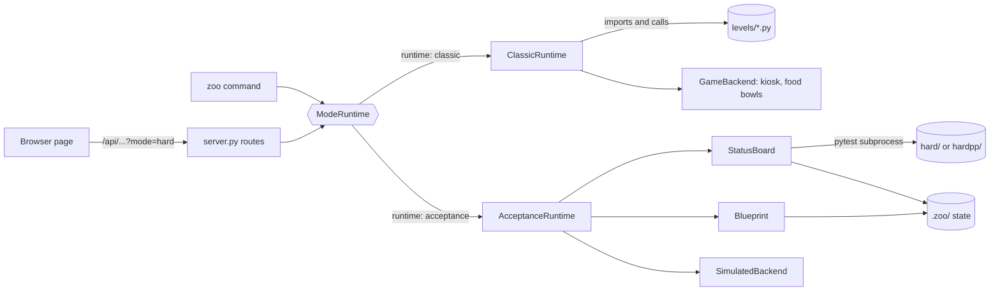

# Architecture

Zoo Ops is two things in one repository:

- **the exercises**: `levels/` (Classic), `hard/` and `hardpp/`, the code a learner edits;
- **the game shell**: `zoo/`, a FastAPI server and a canvas front end that run the learner's
  code (or its acceptance tests) and show what it changes.

The shell never contains a solution, and the exercises never depend on the game.

## Repository map

```
zoo-ops/
├── zoo.sh, zoo.cmd       launchers: set up on the first run, then run `python -m zoo`
├── Dockerfile, compose.yaml
├── pyproject.toml        dependencies, the `zoo` command, ruff, mypy and pytest settings
├── levels/               Classic: zoo-mode.json + ten level folders
├── hard/                 Hard: zoo-mode.json, a real service (src/zoo_platform), tickets, tests, blueprint
├── hardpp/               Hard++: zoo-mode.json, a deterministic simulation (src/zoo_planet), tickets, tests, blueprint
├── zoo/                  the game shell
│   ├── cli.py            the `zoo` command
│   ├── server.py         create_app(): routes, nothing mode-specific
│   ├── modes.py          loads and validates the three zoo-mode.json manifests
│   ├── runtimes.py       ModeRuntime, ClassicRuntime, AcceptanceRuntime
│   ├── registry.py       the Classic levels: files, TODOs, scenes
│   ├── game.py           live hooks: the kiosk and food bowls (Classic runs learner code, hard modes simulate)
│   ├── checks.py         runs acceptance tests in a pytest subprocess, cached by fingerprint
│   ├── blueprint.py      checks a hard mode's architecture design
│   ├── testbench.py      the terminal scoreboard
│   ├── kit.py            FakeClock and Scene, imported by the levels
│   └── static/           the page: js/ (world/, game/), css/
├── tests/                tests of the shell: unit, api, cli, starter guards
└── docs/                 this file, the ADRs, how to write a level
```

## One manifest, one runtime per mode

Every mode is a folder with a `zoo-mode.json` manifest, validated by pydantic when it loads
([ADR 0003](adr/0003-one-manifest-and-runtime-per-mode.md)). The manifest's `runtime` field
picks how the mode is played:



The routes and the CLI only call `ModeRuntime` methods: `systems()`, `public_levels()`,
`backend`, `stream_formatter()`, `blueprint()`, `bench()`, `reset_paths()`. Adding a mode is
adding a folder with a manifest; no route changes.

## What happens when a visitor asks the Owl

1. The page calls `GET /api/game/ask?mode=classic&q=...`.
2. The route asks the runtime for its live backend. In Classic it is a `GameBackend` that
   imports the learner's `levels/l01_cache/cache.py` and `levels/l03_reliability/reliability.py`
   and calls their functions, on one dedicated thread.
3. A TODO raises `NotImplementedError`: the backend falls back to the naive behavior (no cache,
   one long call to the Owl) and adds a note the game shows as a callout.
4. If level 08's `sse_event` works, the answer is streamed as Server-Sent Events, built with the
   learner's own encoder; otherwise the visitor waits for the whole answer in silence.

## What happens in a hard mode

1. `GET /api/game/systems?mode=hard` asks the `StatusBoard` for the last known results.
2. The board fingerprints the project (path, size and mtime of every source file). If it
   changed, it starts one pytest subprocess for all ten tickets in the background
   ([ADR 0002](adr/0002-acceptance-tests-in-a-subprocess.md)) and answers at once with the
   cached results and `checking`.
3. A ticket is **healthy** when its acceptance tests pass **and** its block is correctly placed
   on the Blueprint. The `SimulatedBackend` then plays that pattern in the zoo.

## The front end

Plain ES modules served as they are, no build step
([ADR 0004](adr/0004-no-front-end-build.md)):

- `main.js` boots the page, `api.js` talks to the server, `mode.js` remembers the mode.
- `game.js` owns the state of a shift and its public actions; `game/` holds the screens,
  visitors, pens, incidents, HUD and the rules (timings, prices, thresholds).
- `world.js` owns the canvas and the frame loop; `world/` holds the layers it draws back to
  front (ground, actors, sky, overlays) and turns game events into animations.
- `stations.js`, `dock.js`, `blueprint.js` are the other views.
- `css/` is split by view and loaded in a fixed order.

## State

Everything the game remembers between runs lives in `.zoo/` (or `$ZOO_STATE_DIR`): cached
acceptance results and the learner's blueprint designs. The browser keeps the day counter and
best score in `localStorage`, per mode.

## Tests

| Folder | What it proves |
| --- | --- |
| `tests/unit` | manifests load and are refused when broken, blueprints, checks on a tiny real mode |
| `tests/api` | the shape of every response the page reads (`contract.json`), routes, SSE |
| `tests/cli` | `zoo` commands, `zoo reset` in a real temporary git repository, the benches |
| `tests/starter` | `main` ships the exercises, never their solutions (the slow part runs every hard ticket) |
| `levels/*/test_*.py`, `hard/tests`, `hardpp/tests` | the exercises themselves: red until solved |
